# คู่มือการใช้งาน MiniERP (User Guide)

**เวอร์ชัน:** 1.0 · **อัปเดต:** 21 พฤศจิกายน 2026  
**เหมาะสำหรับ:** เจ้าของธุรกิจ / ผู้ดูแลระบบ / พนักงานที่ใช้งานระบบขาย สต็อก และจัดซื้อ

> ภาพหน้าจอในคู่มือนี้ถ่ายจากแอปจริงโดยใช้ **ข้อมูลตัวอย่างเพื่อการสาธิต**  
> (ข้อมูลดังกล่าวถูกลบออกหลังถ่ายภาพ ไม่ต้องหาในฐานข้อมูลของคุณ)

---

## สารบัญ

1. [เริ่มต้นใช้งาน](#1-เริ่มต้นใช้งาน)
2. [ภาพรวมเมนู](#2-ภาพรวมเมนู)
3. [สถานการณ์ตัวอย่าง: ขายของ 1 รอบ](#3-สถานการณ์ตัวอย่าง-ขายของ-1-รอบ)
4. [คู่มือรายเมนู](#4-คู่มือรายเมนู)
   - [แดชบอร์ด](#41-แดชบอร์ด-dashboard)
   - [สินค้า](#42-สินค้า-products)
   - [ลูกค้า](#43-ลูกค้า-customers)
   - [ผู้ขาย](#44-ผู้ขาย-suppliers)
   - [สาขา](#45-สาขา-branches)
   - [สต็อกสินค้า](#46-สต็อกสินค้า-inventory)
   - [ขาย](#47-ขาย-sales)
   - [จัดซื้อ](#48-จัดซื้อ-purchases)
   - [ใบแจ้งหนี้](#49-ใบแจ้งหนี้-invoices)
   - [รายงานและส่งออก](#410-รายงานและส่งออก-reports)
   - [ตั้งค่า](#411-ตั้งค่า-settings)
   - [ผู้ใช้และสิทธิ์](#412-ผู้ใช้และสิทธิ์-users)
   - [คลังสินค้า](#413-คลังสินค้า-warehouses)
5. [ตารางสิทธิ์ตามบทบาท](#5-ตารางสิทธิ์ตามบทบาท)
6. [คำถามที่พบบ่อย / การแก้ปัญหา](#6-คำถามที่พบบ่อย--การแก้ปัญหา)
7. [ภาคผนวกสำหรับนักพัฒนา](#7-ภาคผนวกสำหรับนักพัฒนา)

---

## 1. เริ่มต้นใช้งาน

### 1.1 เตรียมความพร้อม

- Node.js 20 ขึ้นไป
- Neon Postgres (connection string)
- ไฟล์ `.env.local` (ดู `.env.example`)

```bash
npm install
npm run db:migrate
npm run dev
```

เปิดเบราว์เซอร์ที่ **http://localhost:3000**

> ถ้าเห็นหน้า "MiniERP ยังไม่ได้เชื่อมต่อฐานข้อมูล" แสดงว่ายังไม่ได้ตั้งค่า `.env.local` หรือยังไม่ได้รัน migration

### 1.2 เข้าสู่ระบบ

ที่หน้า `/auth` ให้เลือกแท็บ **เข้าสู่ระบบ** แล้วกรอก:

| ฟิลด์ | ค่าตัวอย่าง |
| --- | --- |
| อีเมล | `admin@minierp.local` |
| รหัสผ่าน | `Admin@12345` |

กด **เข้าสู่ระบบ** ระบบจะพาไปหน้าแดชบอร์ด

> **หมายเหตุ:** ระบบใช้ **อีเมลเป็นชื่อผู้ใช้** ไม่ได้ใช้ username สั้น ๆ เช่น `admin`

---

## 2. ภาพรวมเมนู

แถบด้านซ้ายแบ่งเป็น 4 กลุ่ม:

| กลุ่ม | เมนู | ใช้ทำอะไร |
| --- | --- | --- |
| ภาพรวม | แดชบอร์ด, รายงาน | ดู KPI และส่งออกข้อมูล |
| ข้อมูลหลัก | สินค้า, ลูกค้า, ผู้ขาย, สาขา | สร้าง/แก้ไข/master data |
| ปฏิบัติการ | สต็อกสินค้า, ขาย, จัดซื้อ, ใบแจ้งหนี้ | งานประจำวัน |
| ระบบ | ตั้งค่า, ผู้ใช้และสิทธิ์ | ตั้งค่าบริษัทและผู้ใช้ |

> บนหน้าจอแคบ (มือถือ/แท็บเล็ต) แถบด้านซ้ายจะซ่อนอยู่ ให้กดปุ่ม **☰** มุมขวาบนเพื่อเปิดเมนู — ภาพหน้าจอในคู่มือนี้ถ่ายในโหมดหน้าจอแคบจึงเห็นปุ่ม ☰

---

## 3. สถานการณ์ตัวอย่าง: ขายของ 1 รอบ

แนะนำให้ลองตามลำดับนี้ก่อนใช้งานจริง:

```
เพิ่มสินค้า → เพิ่มลูกค้า → สร้างเอกสารขาย → ออกใบแจ้งหนี้ → รับชำระ → ดูรายงาน
```

### 3.1 เพิ่มสินค้า

`/products` → กด **เพิ่มสินค้า**

| ฟิลด์ | ค่าตัวอย่าง |
| --- | --- |
| SKU | `COFFEE-250` |
| ชื่อสินค้า | `กาแฟอเมริกาโน 250 มล.` |
| ราคาทุน | `25` |
| ราคาขาย | `60` |
| จุดสั่งซื้อ | `12` |
| สต็อกเริ่มต้น | `48` |
| เปิดใช้งาน | ✅ |

กด **บันทึก** → ระบบจะสร้าง movement `Opening stock` ให้เอง

### 3.2 เพิ่มลูกค้า

`/customers` → กด **เพิ่มลูกค้า** → ใส่ชื่อ `ร้านกาแฟสยาม` → บันทึก

### 3.3 สร้างเอกสารขาย

`/sales` → กด **สร้างเอกสารขาย**

- ลูกค้า: `ร้านกาแฟสยาม`
- แถวสินค้า: เลือก `COFFEE-250` → จำนวน `12` → ราคา `60`
- กด **เพิ่มรายการ** เพื่อเพิ่มแถวที่ 2: `SNACK-001` จำนวน `5` ราคา `40`
- ยอดรวมจะคำนวณให้ (`920.00`) → กด **บันทึกเอกสาร**

ผล: สต็อกถูกตัดทันที และระบบพาไปหน้ารายละเอียดเอกสาร

### 3.4 ออกใบแจ้งหนี้

บนหน้ารายละเอียดเอกสารขาย → กด **ออกใบแจ้งหนี้**

- กำหนดวันครบกำหนด (ค่าเริ่มต้น = อีก 7 วัน)
- ใส่หมายเหตุ (ไม่บังคับ) → กด **ออกใบแจ้งหนี้**

ระบบพาไปหน้าใบแจ้งหนี้ ยอดเท่ากับเอกสารขาย (`920.00`)

### 3.5 รับชำระ

หน้าใบแจ้งหนี้ → กด **บันทึกรับชำระ**

| ครั้ง | จำนวน | วิธี | ผลลัพธ์ |
| --- | --- | --- | --- |
| 1 | `400` | โอนเงิน | สถานะ = **ชำระบางส่วน**, คงเหลือ `520` |
| 2 | `520` | เงินสด | สถานะ = **ชำระครบ**, คงเหลือ `0` |

กด **บันทึกการชำระ** ทุกครั้ง ข้อมูลจะแสดงในตาราง "ประวัติการรับชำระ" ทันที

> ถ้ากรอกจำนวนเกินยอดคงเหลือ ระบบจะแจ้งว่า *"จำนวนเงินเกินยอดคงเหลือของใบแจ้งหนี้"* และไม่บันทึก

---

## 4. คู่มือรายเมนู

### 4.1 แดชบอร์ด (Dashboard)

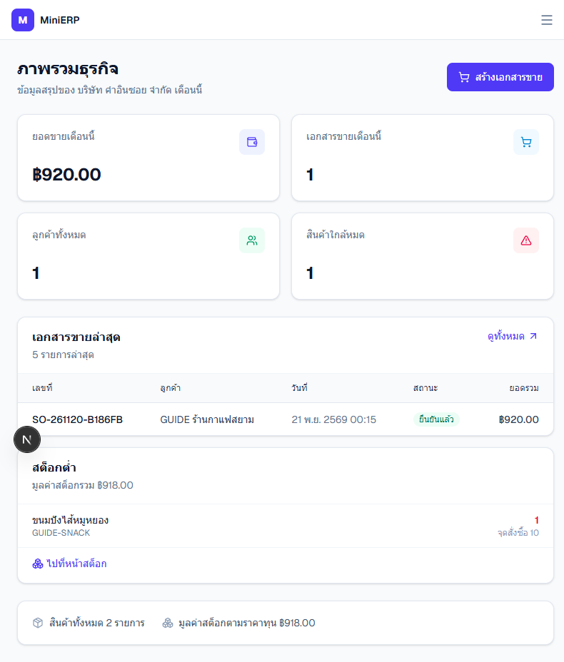

**สิ่งที่เห็น**

| ส่วน | รายละเอียด |
| --- | --- |
| ยอดขายเดือนนี้ | ผลรวมเอกสารขายที่ไม่ถูกยกเลิกในเดือนปัจจุบัน |
| เอกสารขายเดือนนี้ | จำนวนเอกสาร |
| ลูกค้าทั้งหมด | ลูกค้าที่เปิดใช้งานอยู่ |
| สินค้าใกล้หมด | จำนวนสินค้าที่สต็อก ≤ จุดสั่งซื้อ |
| เอกสารขายล่าสุด | 5 เอกสารล่าสุด กดเลขที่เพื่อเปิดรายละเอียด |
| สต็อกต่ำ | รายการที่ต้องสั่งซื้อ + ลิงก์ไปหน้าสต็อก |

**การใช้งาน**

1. ดูภาพรวมเมื่อเข้าสู่ระบบ
2. กด **สร้างเอกสารขาย** มุมขวาบนเพื่อขายได้เลย
3. กด **ดูทั้งหมด →** ในการ์ดเอกสารล่าสุดเพื่อไปหน้า `/sales`
4. กด **ไปที่หน้าสต็อก** หากต้องเติมสินค้า

---

### 4.2 สินค้า (Products)

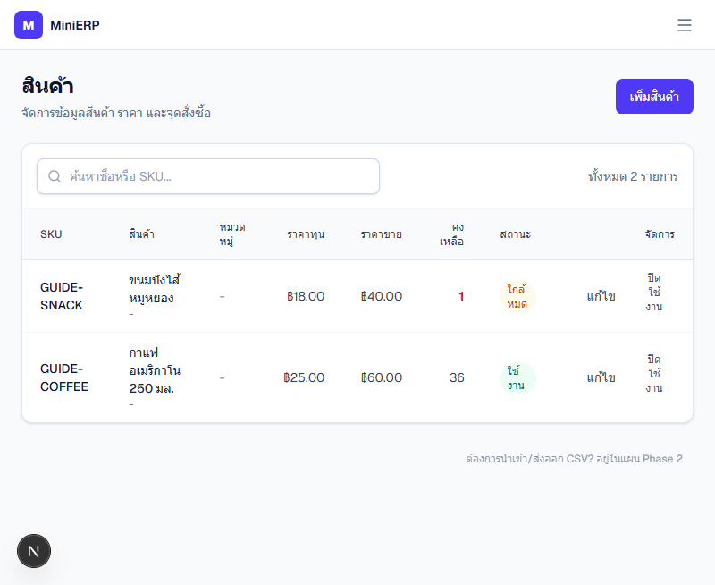

**การเพิ่มสินค้า**

1. กด **เพิ่มสินค้า**
2. กรอก SKU และชื่อสินค้า (บังคับ)
3. ใส่ราคาทุน / ราคาขาย / จุดสั่งซื้อ
4. ใส่ **สต็อกเริ่มต้น** — ระบบจะเรียก `adjust_stock` ให้เอง
5. เลือกหมวดหมู่และหน่วยนับ (ไม่บังคับ)
6. กด **บันทึก**

**การค้นหา** — พิมพ์ชื่อหรือ SKU ในช่องค้นหา ผลลัพธ์จะกรองทันที

**การแก้ไข** — กด **แก้ไข** ในแถวนั้น → แก้ไขข้อมูล → บันทึก  
> การเปลี่ยนจำนวนสต็อกต้องทำที่เมนู **สต็อกสินค้า** เสมอ เพื่อให้มีประวัติ movement

**การปิดใช้งาน** — กด **ปิดใช้งาน** → สินค้าจะไม่แสดงในหน้าขาย/สั่งซื้อ แต่เอกสารเก่ายังอ้างอิงได้  
> ระบบใช้ soft archive ไม่ได้ลบจริง เพื่อรักษาประวัติเอกสาร

**สถานะในตาราง**

| Badge | ความหมาย |
| --- | --- |
| ใช้งาน | พร้อมขาย |
| ใกล้หมด | สต็อก ≤ จุดสั่งซื้อ ควรสั่งเพิ่ม |
| ปิดใช้งาน | เก็บประวัติไว้ แต่ไม่ใช้งาน |

---

### 4.3 ลูกค้า (Customers)

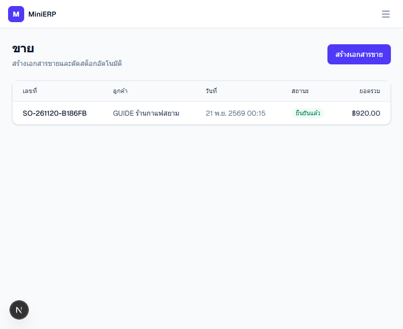

> ภาพด้านบนเป็นหน้า **ขาย** ซึ่งใช้รายชื่อลูกค้าจากเมนูนี้

**การเพิ่มลูกค้า**

1. ไปที่ `/customers` → กด **เพิ่มลูกค้า**
2. กรอกชื่อ (บังคับ)
3. กรอกชื่อผู้ติดต่อ / โทรศัพท์ / อีเมล / ที่อยู่ (ไม่บังคับ)
4. กด **บันทึก**

**การค้นหา** — ค้นหาจากชื่อ, โทรศัพท์ หรืออีเมล

**การปิดใช้งาน** — ใช้เมื่อเลิกเป็นลูกค้า แต่ยังต้องการเก็บเอกสารขายในอดีต

---

### 4.4 ผู้ขาย (Suppliers)

ไปที่ `/suppliers` → กด **เพิ่มผู้ขาย** → กรอกข้อมูลในลักษณะเดียวกับลูกค้า

ข้อมูลผู้ขายจะถูกนำไปเลือกในหน้า **จัดซื้อ** (เฉพาะรายที่เปิดใช้งาน)

---

### 4.5 สาขา (Branches)

ไปที่ `/branches` → กด **เพิ่มสาขา**

| ฟิลด์ | ตัวอย่าง |
| --- | --- |
| ชื่อสาขา | `สาขาหลัก` |
| รหัส | `HQ` |
| ที่อยู่ / โทรศัพท์ | — |

เมื่อสมัครสมาชิกใหม่ ระบบจะสร้างสาขา `Head Office (HQ)` ให้โดยอัตโนมัติอยู่แล้ว

---

### 4.6 สต็อกสินค้า (Inventory)

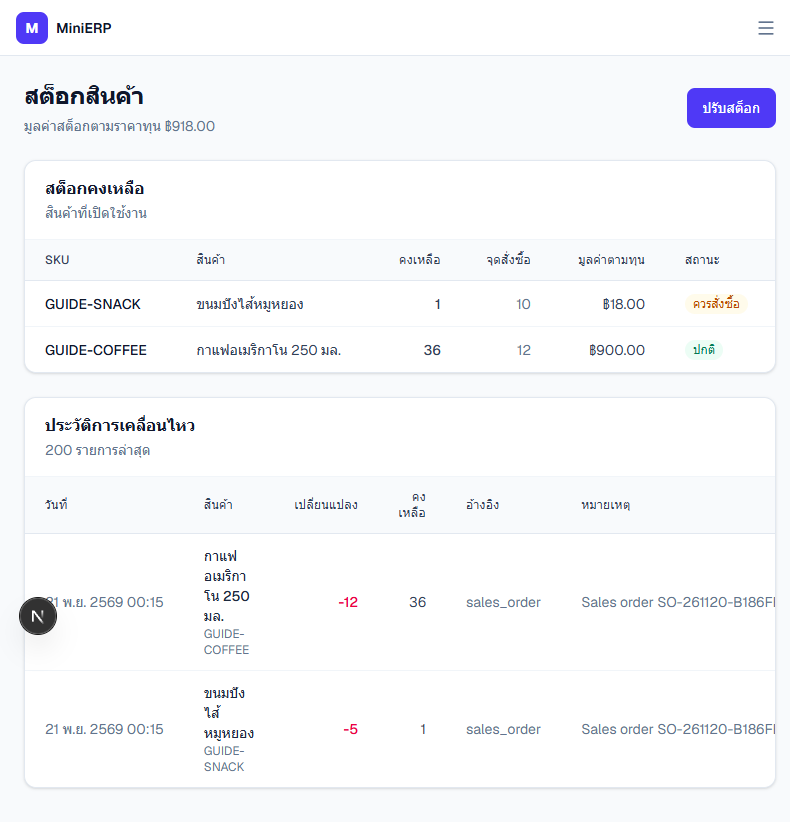

**ส่วนบน — สต็อกคงเหลือแยกคลัง**

- แสดง SKU, ชื่อ, **คลัง**, จำนวนคงเหลือในคลังนั้น, จุดสั่งซื้อ, มูลค่าตามราคาทุน และสถานะ
- Badge **ควรสั่งซื้อ** = ถึงจุดสั่งซื้อแล้ว
- ใช้ฟอร์ม **กรองตามคลัง** เพื่อดูเฉพาะคลังที่เลือก (ค่าเริ่มต้น = ทุกคลัง)
- ยอดรวมทุกคลังของสินค้าดูได้ที่หน้า **สินค้า** (`products.stock_qty`)

**ปรับสต็อก**

1. กด **ปรับสต็อก** มุมขวาบน
2. เลือกสินค้า
3. เลือก **คลังสินค้า** ที่ต้องการปรับ (ค่าเริ่มต้น = คลังที่กำลังกรองอยู่)
4. ใส่จำนวนที่ปรับ:
   - **ค่าบวก** = รับของเพิ่ม (เช่น นับสต็อกแล้วเกิน)
   - **ค่าลบ** = ตัดออก (เช่น ของเสียหาย)
5. ใส่เหตุผล เช่น `นับสต็อกประจำเดือน`
6. กด **บันทึกการปรับ**

> ยอดรวมของสินค้าจะถูกอัปเดตอัตโนมัติตามคลังที่เลือก

**ส่วนล่าง — ประวัติการเคลื่อนไหว**

แสดง 200 รายการล่าสุด: วันที่, สินค้า, จำนวนเปลี่ยนแปลง (`+`/`-`), ยอดคงเหลือหลังรายการ, ประเภทอ้างอิง และหมายเหตุ

| reference_type | ความหมาย |
| --- | --- |
| `sales_order` | ตัดสต็อกจากการขาย |
| `purchase_order` | รับสินค้าจากใบสั่งซื้อ |
| `adjustment` | ปรับสต็อกด้วยตนเอง / opening stock |

---

### 4.7 ขาย (Sales)


**สร้างเอกสารขาย**

1. กด **สร้างเอกสารขาย**
2. เลือกลูกค้า (หรือเว้นว่าง = ลูกค้าทั่วไป)
3. เลือกสาขา (ไม่บังคับ)
4. เลือก **คลังสินค้า** ที่จะตัดสต็อก (ถ้าไม่เลือกจะใช้คลังหลัก `MAIN`)
5. ที่ตารางรายการสินค้า:
   - กด **เลือกสินค้า** → ราคาต่อหน่วยจะเติมให้จากราคาขายอัตโนมัติ
   - ใส่จำนวนและราคา (แก้ราคาได้ถ้าต้องการ)
   - กด **เพิ่มรายการ** สำหรับหลายรายการ
   - กดไอคอนถังขยะเพื่อลบแถว
6. ใส่หมายเหตุ (ไม่บังคับ)
7. ตรวจยอดรวม → กด **บันทึกเอกสาร**

> **สำคัญ:** ระบบตรวจสต็อกจากคลังที่เลือกและตัดสต็อกในขั้นตอนเดียว หากสินค้าใดไม่พอ เอกสารทั้งฉบับจะไม่ถูกบันทึก และแจ้งว่า *"สต็อกสินค้า XXX ไม่เพียงพอ"*

**ดูรายละเอียด** — กดเลขที่เอกสาร (เช่น `SO-261120-B186FB`)

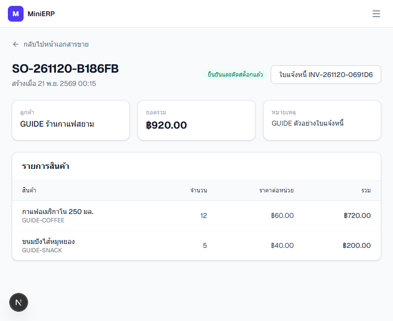

หน้านี้แสดง:
- ลูกค้า / ยอดรวม / หมายเหตุ
- ตารางรายการสินค้า
- ปุ่ม **ออกใบแจ้งหนี้** (ถ้ายังไม่มีใบแจ้งหนี้)
- ลิงก์ไป **ใบแจ้งหนี้ XXX** (ถ้าออกแล้ว)

---

### 4.8 จัดซื้อ (Purchases)

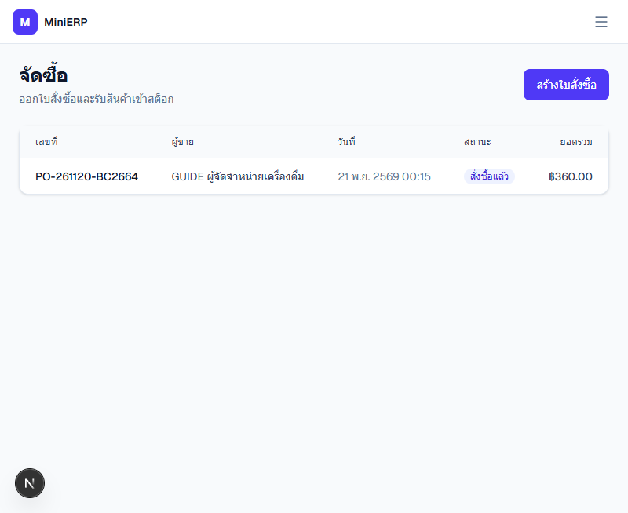

**สร้างใบสั่งซื้อ**

1. กด **สร้างใบสั่งซื้อ**
2. เลือกผู้ขาย (ไม่บังคับ)
3. เลือกสาขา (ไม่บังคับ)
4. เลือก **คลังสินค้า** ที่จะรับของ (ค่าเริ่มต้น = คลังหลัก `MAIN`)
5. เพิ่มรายการสินค้า — ราคาจะเติมจาก **ราคาทุน** อัตโนมัติ
6. กด **บันทึกเอกสาร**

สถานะเริ่มต้นคือ **สั่งซื้อแล้ว** — สต็อกยังไม่เพิ่ม

**รับสินค้าเข้าสต็อก**

1. เปิดรายละเอียดใบสั่งซื้อ
2. กด **รับสินค้า**
3. ระบบจะ:
   - เพิ่มสต็อกตามจำนวนทุกแถว **ในคลังที่เลือกตอนสร้างใบสั่งซื้อ**
   - บันทึก movement `purchase_order`
   - เปลี่ยนสถานะเป็น **รับสินค้าแล้ว** และบันทึกวันที่รับ

> รับสินค้าได้ครั้งเดียว ถ้ากดซ้ำระบบจะแจ้งว่า *"เอกสารนี้รับสินค้าแล้วหรือถูกยกเลิก"*

---

### 4.9 ใบแจ้งหนี้ (Invoices)

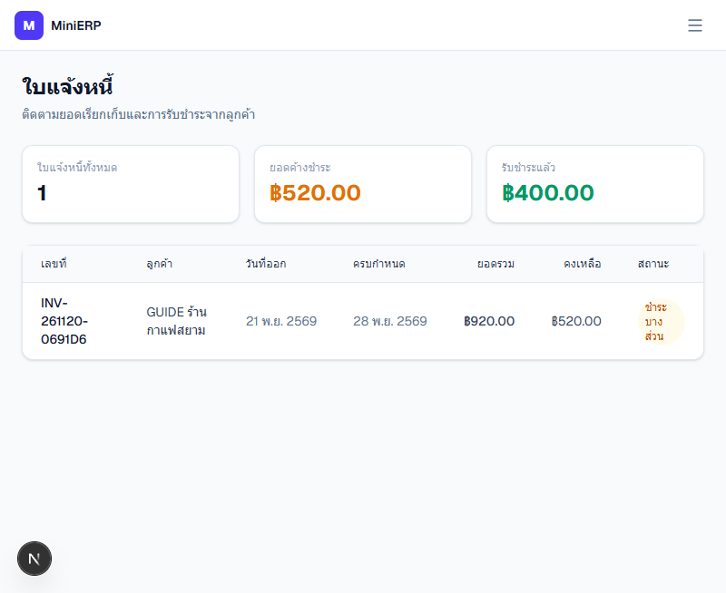

**ภาพรวม**

| การ์ด | ความหมาย |
| --- | --- |
| ใบแจ้งหนี้ทั้งหมด | จำนวนใบทั้งหมด |
| ยอดค้างชำระ | ผลรวม (ยอดรวม − รับชำระแล้ว) ของใบที่ยังไม่ชำระครบ |
| รับชำระแล้ว | ผลรวมเงินที่รับทั้งหมด |

**ตาราง** แสดงเลขที่, ลูกค้า, วันที่ออก, วันครบกำหนด, ยอดรวม, ยอดคงเหลือ, สถานะ

| สถานะ | ความหมาย |
| --- | --- |
| ออกแล้ว | ยังไม่มีการชำระ |
| ชำระบางส่วน | ชำระแล้วแต่ยังไม่ครบ |
| ชำระครบ | ยอดคงเหลือ = 0 |
| ยกเลิก | ไม่เรียกเก็บ |

**รายละเอียดใบแจ้งหนี้**

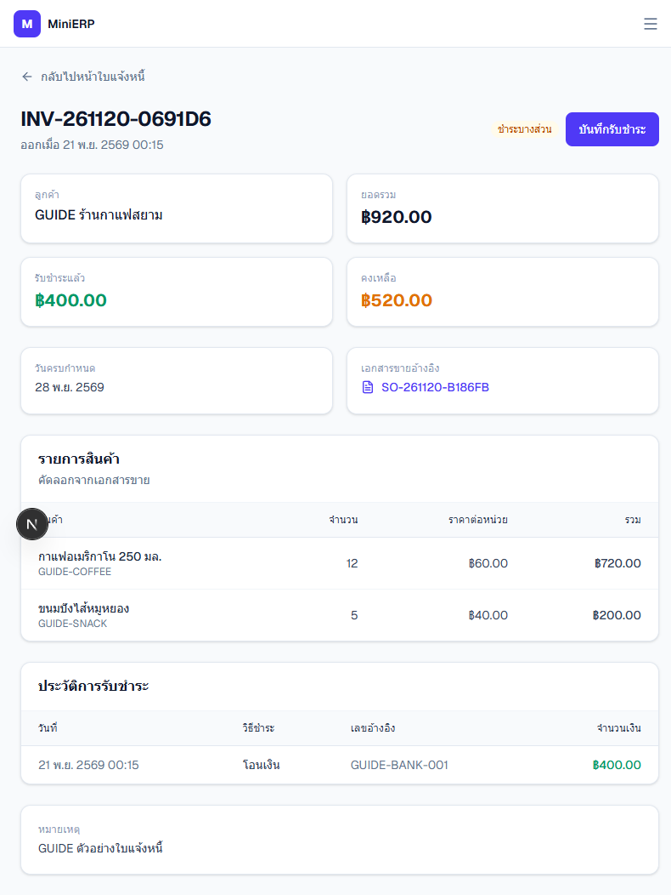

- การ์ดสรุป: ลูกค้า / ยอดรวม / รับชำระแล้ว / คงเหลือ
- วันครบกำหนด + ลิงก์ไปเอกสารขายอ้างอิง
- รายการสินค้า (คัดลอกจากเอกสารขาย)
- ประวัติการรับชำระ (วันที่, วิธี, เลขอ้างอิง, จำนวน)
- ปุ่ม **บันทึกรับชำระ** (แสดงเมื่อมียอดคงเหลือ)

**ข้อกำหนด**

- หนึ่งเอกสารขายออกใบแจ้งหนี้ได้ **ครั้งเดียว**
- ยอดใบแจ้งหนี้เท่ากับยอดเอกสารขายโดยอัตโนมัติ
- รับชำระได้หลายครั้งจนครบ
- ชำระเกินยอดไม่ได้

---

### 4.10 รายงานและส่งออก (Reports)

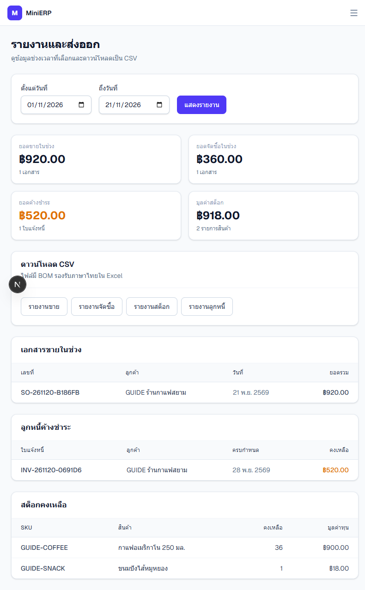

**เลือกช่วงเวลา**

1. กรอก **ตั้งแต่วันที่** และ **ถึงวันที่**
2. กด **แสดงรายงาน**
3. ค่าเริ่มต้นคือวันที่ 1 ของเดือนนี้จนถึงวันนี้

**ตัวเลข summary**

| ตัวเลข | รายละเอียด |
| --- | --- |
| ยอดขายในช่วง | เอกสารขายที่ไม่ถูกยกเลิก |
| ยอดจัดซื้อในช่วง | ใบสั่งซื้อที่ไม่ถูกยกเลิก |
| ยอดค้างชำระ | ใบแจ้งหนี้ที่ยังไม่ชำระครบ |
| มูลค่าสต็อก | ผลรวม `สต็อก × ราคาทุน` ของสินค้าที่เปิดใช้งาน |

**ดาวน์โหลด CSV**

กดปุ่มใดปุ่มหนึ่งในการ์ด "ดาวน์โหลด CSV":

| ปุ่ม | ไฟล์ | ข้อมูล |
| --- | --- | --- |
| รายงานขาย | `sales_YYYY-MM-DD_YYYY-MM-DD.csv` | เลขที่, วันที่, ลูกค้า, สถานะ, ยอดรวม |
| รายงานจัดซื้อ | `purchases_....csv` | เลขที่, วันที่, ผู้ขาย, สถานะ, ยอดรวม |
| รายงานสต็อก | `stock.csv` | SKU, ชื่อ, คงเหลือ, จุดสั่งซื้อ, ราคาทุน, มูลค่า |
| สต็อกแยกคลัง | `warehouse-stock.csv` | คลัง, SKU, ชื่อ, คงเหลือ, จุดสั่งซื้อ, ราคาทุน, มูลค่า |
| รายงานลูกหนี้ | `receivables_....csv` | ใบแจ้งหนี้, ครบกำหนด, ลูกค้า, ยอดรวม, ชำระแล้ว, คงเหลือ |

> ไฟล์ CSV มี **BOM** รองรับภาษาไทยใน Excel  
> ต้องเข้าสู่ระบบก่อนดาวน์โหลด (ไม่มี session → `401 Unauthorized`)

**ตารางด้านล่าง** แสดงเอกสารขายในช่วง, ลูกหนี้ค้างชำระ, และสต็อกคงเหลือ

---

### 4.11 ตั้งค่า (Settings)

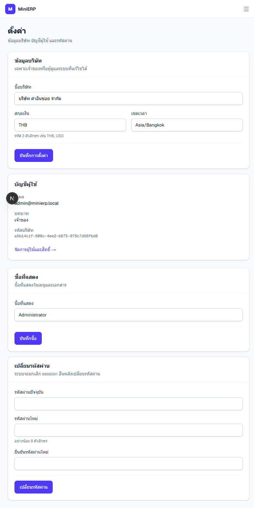

**ข้อมูลบริษัท** (owner/admin เท่านั้น)

| ฟิลด์ | ตัวอย่าง |
| --- | --- |
| ชื่อบริษัท | `บริษัท ตัวอย่าง จำกัด` |
| สกุลเงิน | `THB` (3 ตัวอักษร เช่น THB, USD) |
| เขตเวลา | `Asia/Bangkok` |

กด **บันทึกการตั้งค่า** — ค่าเงินจะถูกใช้แสดงผลในทุกหน้า (ผ่าน `formatCurrency`)

**บัญชีผู้ใช้** — แสดงอีเมล, บทบาท, รหัสบริษัท + ลิงก์ **จัดการผู้ใช้และสิทธิ์ →**

**ชื่อที่แสดง** — แก้ชื่อที่แสดงในเมนูและเอกสาร → กด **บันทึกชื่อ**

**เปลี่ยนรหัสผ่าน**

1. กรอก **รหัสผ่านปัจจุบัน**
2. กรอก **รหัสผ่านใหม่** (อย่างน้อย 8 ตัวอักษร)
3. กรอก **ยืนยันรหัสผ่านใหม่** ให้ตรงกัน
4. กด **เปลี่ยนรหัสผ่าน**

หลังเปลี่ยนสำเร็จ session อื่นจะถูกยกเลิก ต้อง login ใหม่ด้วยรหัสผ่านใหม่

---

### 4.12 ผู้ใช้และสิทธิ์ (Users)

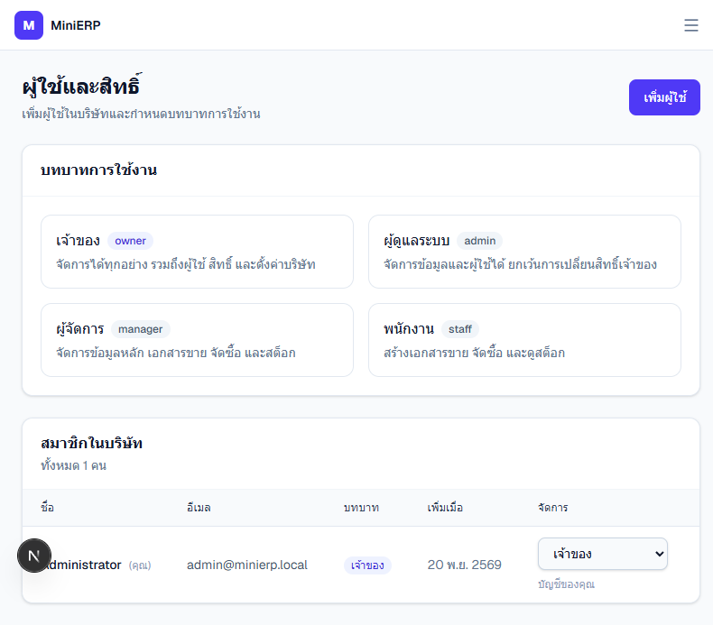

**เพิ่มผู้ใช้**

1. กด **เพิ่มผู้ใช้** (owner/admin เท่านั้น)
2. กรอกชื่อที่แสดง
3. กรอกอีเมล (ต้องไม่ซ้ำกับผู้ใช้ที่มีอยู่แล้ว)
4. กรอกรหัสผ่านเริ่มต้น (อย่างน้อย 8 ตัวอักษร)
5. เลือกสิทธิ์ → กด **เพิ่มผู้ใช้**
6. แจ้งอีเมลและรหัสผ่านให้ผู้ใช้ทางช่องทางของคุณ

> ระบบยังไม่ได้ส่งอีเมลเชิญอัตโนมัติ ต้องแจ้งรหัสผ่านให้ผู้ใช้เอง

**เปลี่ยนสิทธิ์** — ในตาราง "สมาชิกในบริษัท" ให้เลือกบทบาทใหม่จาก dropdown

**ลบผู้ใช้** — กด **ลบ** → ยืนยันในหน้าต่างยืนยัน

**ข้อจำกัด**

- ไม่สามารถเปลี่ยนสิทธิ์หรือลบ **บัญชีตัวเอง** ได้
- ต้องมี **owner อย่างน้อย 1 คน** ในบริษัทเสมอ
- admin แก้ไขบทบาท owner ไม่ได้ และตั้งสิทธิ์ owner ให้คนอื่นไม่ได้

---

### 4.13 คลังสินค้า (Warehouses)

> ภาพหน้าจอในคู่มือชุดนี้ถ่ายก่อนเพิ่มเมนูคลังสินค้า หน้าตารางจึงอาจมีคอลัมน์เพิ่มจากรูปด้านล่าง

**หลักการ**

- ระบบสร้างคลังหลัก `Main Warehouse` (รหัส `MAIN`) ให้ทุกบริษัทโดยอัตโนมัติ
- เมื่อเพิ่มคลังใหม่ ระบบจะสร้างแถวสต็อก 0 สำหรับทุกสินค้าในคลังนั้นให้ทันที
- ทุกการขาย / รับสินค้า / ปรับสต็อก จะอัปเดต:
  1. จำนวนใน **คลังที่เลือก**
  2. ยอดรวม `products.stock_qty` (แสดงที่หน้าสินค้าและแดชบอร์ด)
  3. ประวัติ `stock_movements` พร้อมชื่อคลัง

**เพิ่มคลัง**

1. ไปที่ `/warehouses` → กด **เพิ่มคลัง**
2. กรอกชื่อคลัง (บังคับ) และรหัสคลัง (ไม่บังคับ แต่ควรไม่ซ้ำ)
3. เลือกสาขาที่คลังตั้งอยู่ (ไม่บังคับ)
4. กด **บันทึกคลัง**

**แก้ไข / ปิดใช้งาน**

- กด **แก้ไข** เพื่อเปลี่ยนชื่อ รหัส หรือสาขา
- กด **ปิดใช้งาน** เพื่อไม่ให้เลือกในเอกสารใหม่
- **คลังหลัก `MAIN` ปิดใช้งานไม่ได้** เพราะระบบใช้เป็นค่าเริ่มต้น

**การเลือกคลังในงานประจำวัน**

| งาน | ที่เลือกคลัง |
| --- | --- |
| ขาย | ในหน้าต่าง "สร้างเอกสารขาย" → ฟิลด์ **คลังสินค้า** |
| จัดซื้อ | ในหน้าต่าง "สร้างใบสั่งซื้อ" → ฟิลด์ **คลังสินค้า** (ใช้ตอนรับของ) |
| ปรับสต็อก | ในหน้าต่าง "ปรับสต็อก" → ฟิลด์ **คลังสินค้า** |
| ดูสต็อก | ฟอร์ม **กรองตามคลัง** ที่หน้า `/inventory` |

**ข้อควรระวัง**

- ถ้าคลังที่เลือกมียอดไม่พอ ระบบจะบล็อกการขาย แม้ยอดรวมทุกคลังจะเพียงพอ
  (ต้องปรับย้ายสต็อกระหว่างคลังก่อน — ทำโดยปรับลบคลังหนึ่งแล้วปรับบวกอีกคลัง)
- การลบคลังจะลบแถวสต็อกของคลังนั้นด้วย จึงควร **ปิดใช้งาน** แทนการลบ

---

## 5. ตารางสิทธิ์ตามบทบาท

| ความสามารถ | owner | admin | manager | staff |
| --- | :---: | :---: | :---: | :---: |
| ดูแดชบอร์ด / รายงาน | ✅ | ✅ | ✅ | ✅ |
| สร้าง/แก้สินค้า, ลูกค้า, ผู้ขาย, สาขา | ✅ | ✅ | ✅ | ดูอย่างเดียว |
| จัดการคลังสินค้า | ✅ | ✅ | ❌ | ❌ |
| ปรับสต็อก (เลือกคลัง) | ✅ | ✅ | ✅ | ✅ |
| สร้างเอกสารขาย / รับชำระ | ✅ | ✅ | ✅ | ✅ |
| สร้างใบสั่งซื้อ / รับสินค้า | ✅ | ✅ | ✅ | ✅ |
| ออกใบแจ้งหนี้ | ✅ | ✅ | ✅ | ✅ |
| ตั้งค่าบริษัท | ✅ | ✅ | ❌ | ❌ |
| เพิ่ม/ลบ/เปลี่ยนสิทธิ์ผู้ใช้ | ✅ | ✅* | ❌ | ❌ |
| เปลี่ยนชื่อ/รหัสผ่านตัวเอง | ✅ | ✅ | ✅ | ✅ |

\* admin ไม่สามารถแก้ไขบัญชี owner หรือตั้งสิทธิ์ owner ได้

---

## 6. คำถามที่พบบ่อย / การแก้ปัญหา

### Q: ล็อกอินไม่ได้
- ตรวจสอบว่ากรอก **อีเมล** ไม่ใช่ชื่อผู้ใช้
- รหัสผ่านต้องตรงตัว (case-sensitive)
- ถ้าลืมรหัสผ่าน ตอนนี้ยังไม่มีหน้า "ลืมรหัสผ่าน" — ให้ owner/admin รีเซ็ตโดยลบผู้ใช้แล้วเพิ่มใหม่ หรือเปลี่ยนรหัสผ่านผ่านฐานข้อมูล

### Q: ขึ้นว่า "ยังไม่ได้เชื่อมต่อฐานข้อมูล"
- ตรวจไฟล์ `.env.local` ว่ามี `DATABASE_URL`, `BETTER_AUTH_SECRET`, `BETTER_AUTH_URL`
- รัน `npm run db:migrate` และรีสตาร์ท server

### Q: บันทึกเอกสารขายแล้วขึ้น "สต็อกไม่เพียงพอ"
- ระบบตรวจจาก **คลังที่เลือกในเอกสาร** ไม่ใช่ยอดรวมทุกคลัง
- ไปที่ `/inventory` → กรองคลังที่ใช้ขาย → กด **ปรับสต็อก** ด้วยค่าบวกเพื่อเติมของก่อน
- หรือเลือกคลังอื่นที่มีของเพียงพอในเอกสารขาย

### Q: เห็นปุ่ม ☰ แต่ไม่เห็นเมนูด้านซ้าย
- นี่คือโหมดหน้าจอแคบ ปกติของ Responsive UI กด ☰ เพื่อเปิดเมนู หรือขยายหน้าต่างเบราว์เซอร์

### Q: เปิด CSV แล้วภาษาไทยเพี้ยน
- ควรเปิดด้วย Excel ที่รองรับ UTF-8 with BOM (ไฟล์ที่ระบบสร้างมี BOM อยู่แล้ว)
- ถ้ายังเพี้ยน ให้ import ข้อมูลผ่าน **Data → From Text/CSV** แล้วเลือก encoding `UTF-8`

### Q: รับชำระแล้วสถานะไม่เปลี่ยนเป็น "ชำระครบ"
- ตรวจยอดที่รับสะสมว่าครบตามยอดรวมแล้วหรือยัง
- กด **F5** หรือ `router.refresh()` ด้วยการเปิดหน้าใหม่

### Q: เปลี่ยนรหัสผ่านแล้วเข้าไม่ได้
- ระบบยกเลิก session อื่นทั้งหมด → ต้องล็อกอินใหม่ด้วยรหัสผ่านใหม่

---

## 7. ภาคผนวกสำหรับนักพัฒนา

### คำสั่งที่มีประโยชน์

```bash
npm run dev          # development server
npm run build        # production build
npm run typecheck    # TypeScript
npm run lint         # ESLint
npm run db:migrate   # apply migration กับ Neon
npm run db:studio    # เปิด Drizzle Studio
```

### ตำแหน่งไฟล์สำคัญ

| เรื่อง | ไฟล์ |
| --- | --- |
| หน้าเว็บทั้งหมด | `src/app/` |
| Server Actions | `src/features/*/actions.ts` |
| การเข้าถึงข้อมูล | `src/repositories/*.ts` |
| Drizzle schema | `src/db/schema.ts` |
| Migration | `drizzle/0000_init.sql` … `0003_invoices_users.sql` |
| ตรวจสอบ session | `src/lib/auth.ts`, `src/proxy.ts` |
| ตัวอย่างภาพหน้าจอ | `docs/assets/screenshots/` |

### CSV endpoint (ต้องมี session)

```
GET /api/reports/sales?from=2026-11-01&to=2026-11-30
GET /api/reports/purchases?from=2026-11-01&to=2026-11-30
GET /api/reports/stock
GET /api/reports/warehouse-stock
GET /api/reports/receivables?from=2026-11-01&to=2026-11-30
```

### หมายเหตุเรื่องความปลอดภัย

- ข้อมูลทุกตารางแยกตาม `company_id` และทุก query ถูกกรองฝั่งเซิร์ฟเวอร์
- ห้ามส่ง `company_id` หรือ `user_id` มาจาก client — ระบบดึงจาก session เสมอ
- งานที่ต้องการ atomic ทำใน Postgres function (ขาย, รับของ, ปรับสต็อก, ออกใบแจ้งหนี้, รับชำระ)

---

**จบคู่มือ** — หากต้องการเพิ่มส่วนใด (เช่น ภาพหน้าจอตอนเปิด Dialog, คู่มือสำหรับพนักงานคลังสินค้าแบบเฉพาะทาง) แจ้งได้เลยครับ
